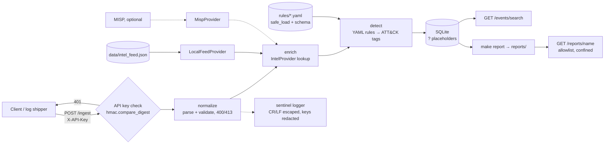

# Sentinel-Lite

A small log-enrichment service for the ULBS Cybersecurity Master, Module 4 lab
(Risk and Damage Management, AI-driven security engineering).

It accepts security events over HTTP and normalizes them to an ECS-like shape. It enriches
the source IP against threat intelligence, runs YAML detection rules mapped to MITRE ATT&CK
and stores the result in SQLite.

The project started deliberately vulnerable. The commit tagged `baseline-vulnerable` carries
ten seeded bugs (B-01 to B-10). Each one is fixed in its own pull request, with a regression
test that fails on the tag and passes on `main`.

## Run it

Needs Python 3.11+, `git` and `make` (on Windows, Git Bash plus a `make.exe`). Everything
installs inside this folder (`.venv/`, `.cache/`).

```sh
make setup   # venv, pinned runtime + dev deps, a random API key in .env, git hooks
make check   # ruff, register check, pytest, bandit, pip-audit, build check (about 25 s)
make run     # serves http://127.0.0.1:5000 (loopback only)
```

Try it from a second shell. Every endpoint except `/health` needs the `X-API-Key` header,
whose value `make setup` wrote to `.env`.

```sh
. ./.env                                        # sets SENTINEL_API_KEY in this shell
curl -s http://127.0.0.1:5000/health
curl -s -X POST http://127.0.0.1:5000/ingest -H "X-API-Key: $SENTINEL_API_KEY" \
     -H "Content-Type: application/json" -d @samples/SL-0001/positive.json
curl -s "http://127.0.0.1:5000/events/search?user=root" -H "X-API-Key: $SENTINEL_API_KEY"
curl -s "http://127.0.0.1:5000/intel/check?ip=203.0.113.66" -H "X-API-Key: $SENTINEL_API_KEY"
curl -s -X POST http://127.0.0.1:5000/admin/rules/reload -H "X-API-Key: $SENTINEL_API_KEY"
curl -s http://127.0.0.1:5000/reports/sample-summary.txt -H "X-API-Key: $SENTINEL_API_KEY"
```

Other targets:

- `make test` runs pytest.
- `make test-seeded` runs only the seeded-bug regressions.
- `make report` writes `reports/summary.txt`.
- `make register` rebuilds the risk register.
- `make lock` re-resolves `constraints.txt`.

## Architecture



| Module | Role |
|---|---|
| `app/__init__.py` | app factory, routes, API-key check |
| `app/config.py` | settings from the environment, once (`127.0.0.1`, 64 KiB body cap) |
| `app/pipeline.py` | `normalize → enrich → detect`. `normalize` is the input boundary |
| `app/intel.py` | `IntelProvider` interface, local feed, MISP provider |
| `app/rules.py` | rule loading: `yaml.safe_load` then a strict schema |
| `app/store.py` | the only SQLite code, parameterized |
| `app/logsafe.py` | log filter: one line per event, no keys |

MISP and Shodan are not installed. `MispProvider` talks to a MISP REST API when one is
configured, and its tests use a stub session. Shodan is described in `docs/PROJECT.md` only.

## Governance

This repository uses **GitHub route 4**. It is a private repo on a personal GitHub Free
account, where rulesets and branch protection are refused (`docs/evidence/github-route.md`).
Protection of `main` is layered instead:

1. **Local git hooks** (`.githooks/`): the pre-commit hook refuses commits on `main` and runs
   gitleaks. The pre-push hook refuses pushes to `main` and force pushes.
2. **Agent guardrails** (`.claude/`): deny rules and a PreToolUse hook block the AI agent from
   pushing to `main`, force-pushing, skipping hooks, reading secrets or editing its own rules.
3. **CI** on every PR: `make check`, gitleaks and zizmor, with every action pinned to a commit
   SHA. That pinning is enforced by a repository policy.
4. **Governance workflow** on every push to `main`: it fails if any commit since the baseline
   didn't arrive through a merged PR with green CI.

Every PR uses `.github/pull_request_template.md`, with its self-review checklist and an
"Agent review" section from `skills/review-pr`.

## Documents

| File | What it holds |
|---|---|
| `RISK-REGISTER.xlsx` / `.md` | ten risks, scores, controls, evidence (source: `docs/risk-register.yaml`) |
| `docs/BUG-REPORT.md` | every seeded bug: exploit, blast radius, fix, proof, residual risk, chains |
| `docs/PROJECT.md` | scope, architecture, AI workflow, limits |
| `docs/evidence/` | command output behind every claim |
| `CLAUDE.md`, `memory/`, `skills/` | the AI agent's context, corrections and procedures |
| `SECURITY.md`, `CONTRIBUTING.md` | reporting and contribution rules |
